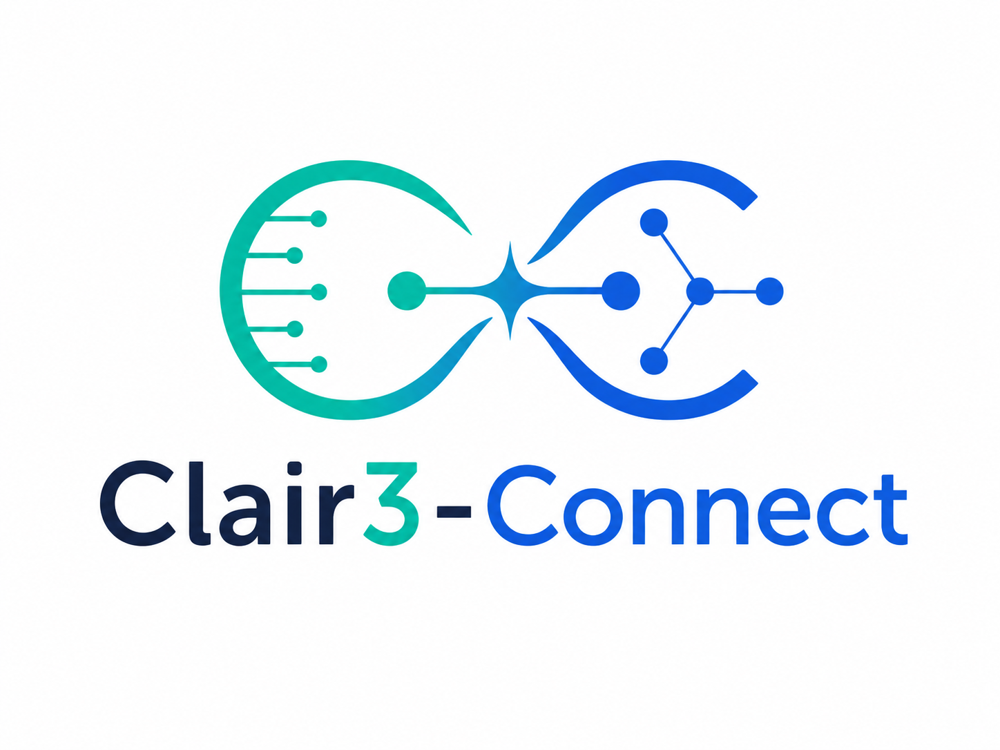
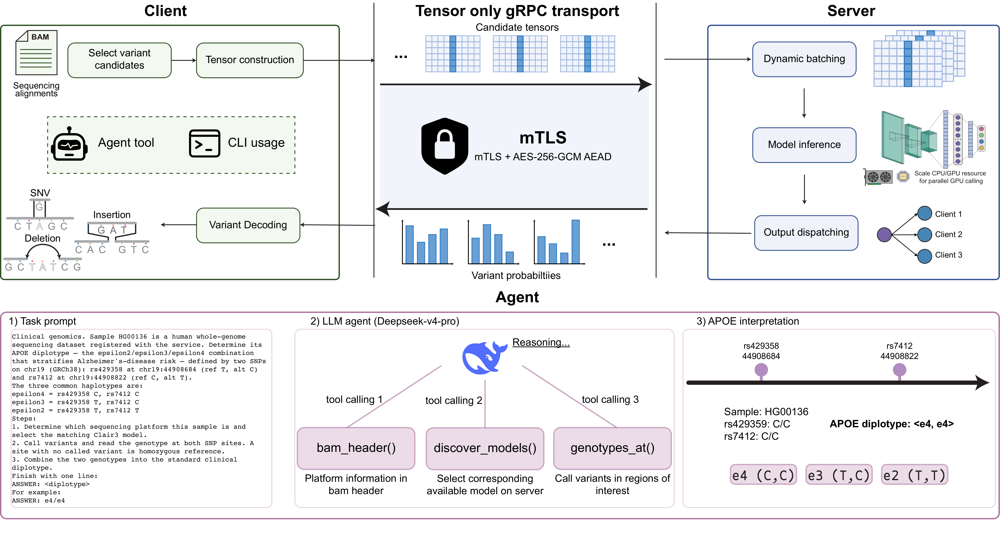

# Clair3-Connect
<p align="center">
  
</p>
<p align="center">
  <a href="https://www.biorxiv.org/content/10.64898/2026.06.25.734665v1"></a>
  <a href="https://github.com/HKU-BAL/Clair3-Connect"></a>
  <a href="LICENSE"></a>
</p>

Client-server interfaces for efficient agent-driven variant calling.

Clair3-Connect re-architects [Clair3](https://github.com/HKU-BAL/Clair3), a
deep-learning-based long-read variant caller, into a **client-server system**.
The **client** performs all genomics and holds the identifiable data: it reads
the alignments and reference, builds feature tensors, and decodes the returned
probabilities into a VCF. The **server** runs only neural-network inference and
receives only feature tensors, so sample identifiers and genomic context never
leave the client. The client exposes **schema-defined, agent-facing tools** that
an LLM agent invokes through single structured calls.

<p align="center">
  <a href="figs/Fig1.pdf"></a>
</p>

## Install

```bash
./install.sh client      # client only — no GPU, no LibTorch
./install.sh server      # server — auto-detects CUDA, downloads the matching LibTorch
./install.sh all
```

Binaries are placed in `bin/`. Without `sudo`, install the toolchain into the
bundled conda environment first:

```bash
mamba env create -f environment.yml   # or: conda env create -f environment.yml
conda activate clair3-connect
./install.sh client
```

## Usage

### Interactive mode (recommended)

Run either binary with **no arguments** for a guided setup that prompts for every
input and validates as it goes:

```bash
clair3-connect-server     # walks through registry, device, and TLS/AEAD (can mint a PKI)
clair3-connect            # walks through BAM, reference, region, model, and server +
                          # security, with a live connection check before it runs
```

If the connection check fails (e.g. a TLS/plaintext mismatch), it explains the
cause and lets you fix just the connection settings and retry — without
re-entering the other inputs.

### Command-line mode

Start the inference server with a model registry (a YAML listing the TorchScript
models; `--device cpu` or `cuda:0`):

```bash
clair3-connect-server --model-registry registry.yaml --device cuda:0
```

Call variants from the client (no GPU needed):

```bash
clair3-connect \
  --bam sample.bam --ref reference.fa --region chr20:1-64444167 \
  --fa-model full_alignment_ont_hac_v500 --platform ont \
  --server http://127.0.0.1:50051 --output ./out
```

The VCF is written to `out/merge_output.vcf`. The client runs full-alignment
only by default; add `--full-pipeline` for the classic Clair3 flow.

### More

- **Models** — convert a Clair3 model and register it in one step:
  `python tools/convert_and_register.py --model-dir <clair3_model> --platform ont --name ont_hac_v500 --registry registry.yaml`
- **Secure transport** — add mutual TLS + AES-256-GCM with `--tls-*` and
  `--aead-key` on both the server and the client.

## Agent usage

The client is driven by an LLM agent through **schema-defined, agent-facing
tools** — the agent calls operations like `discover_models`, `bam_header`,
`call_variants`, and `genotypes_at` with single structured calls and never
handles file paths or flags itself. The reference tool definitions are in
[`agent/clair3_connect_tools.py`](agent/clair3_connect_tools.py), with an
optional MCP server in [`agent/mcp_server.py`](agent/mcp_server.py). The
[`agent/`](agent) directory also contains the APOE-diplotyping driver used in
the paper (`agent.py`, `run_e4.sh`).

## Citation

If you use Clair3-Connect in your work, please cite our preprint:

> Xian Yu, Zhenxian Zheng, Lei Chen, Zilan Qin, Xinyi Guo, Minggao He, Ruibang Luo.
> *Client-server interfaces enable efficient agent-driven variant calling.*
> bioRxiv 2026.06.25.734665 (2026).
> doi: [https://doi.org/10.64898/2026.06.25.734665](https://doi.org/10.64898/2026.06.25.734665)

<details>
<summary>BibTeX</summary>

```bibtex
@article{yu2026clair3connect,
  title     = {Client-server interfaces enable efficient agent-driven variant calling},
  author    = {Yu, Xian and Zheng, Zhenxian and Chen, Lei and Qin, Zilan and Guo, Xinyi and He, Minggao and Luo, Ruibang},
  journal   = {bioRxiv},
  year      = {2026},
  doi       = {10.64898/2026.06.25.734665},
  url       = {https://doi.org/10.64898/2026.06.25.734665},
  publisher = {Cold Spring Harbor Laboratory}
}
```

</details>

Corresponding author: Ruibang Luo (rbluo@cs.hku.hk).

Built on [Clair3](https://github.com/HKU-BAL/Clair3). Licensed under the
[BSD 3-Clause License](LICENSE).
